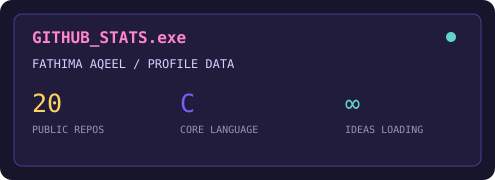
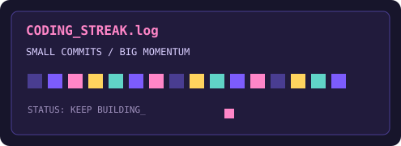
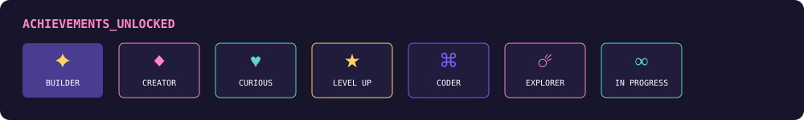

<div align="center">
  

  

  <h1>Hi, I'm Fathima 👋</h1>
  

  <p>
    <a href="https://github.com/fishaq1104">
      
    </a>
    <a href="https://www.linkedin.com/in/fathima-aqeel-530718323/">
      
    </a>
    <a href="https://www.instagram.com/fishaq1104/">
      
    </a>
    <a href="https://fishaq1104.github.io/MyProfile/">
      
    </a>
  </p>
</div>

---

## `> who_am_i`

I'm Fathima, a Computer Science student at **Al Ain University** and a software development student at **42 Abu Dhabi**.

I like learning by making things: a shell, a game, a small web page, a chatbot, or an interface that feels nice to use. Some projects are polished, some are experiments, and some are just me figuring out how a new idea works.

```text
┌──────────────────────────────────────────────┐
│  STATUS: online                              │
│  CURRENT QUEST: learn, build, repeat         │
│  FAVOURITE MODE: creative problem-solving   │
│  NEXT LEVEL: loading...                      │
└──────────────────────────────────────────────┘
```

## `> inventory`

<p>
  
  
  
  
  
  
  
  
  
  
  
  
</p>
<!-- <p align="center">
  
  <br />
  <sub><strong>linux mode: enabled</strong> 🐧</sub>
</p> -->

## `> main_quests`

<table>
  <tr>
    <td width="50%" valign="top">
      <h3>🌡️ <a href="https://github.com/fishaq1104/Cyberthron">Cyberthron</a></h3>
      <p>A climate-responsive mobility platform for Abu Dhabi, with accessibility features, sustainable routes, bilingual support, and an AI assistant.</p>
      <sub>TypeScript · React · Node.js</sub>
    </td>
    <td width="50%" valign="top">
      <h3>🤖 <a href="https://github.com/fishaq1104/The-Everyday-Automation-Chatbot">Everyday Automation Chatbot</a></h3>
      <p>A Discord bot for news, weather, reading progress, and daily reminders.</p>
      <sub>Python · Discord · SQLite</sub>
    </td>
  </tr>
  <tr>
    <td width="50%" valign="top">
      <h3>🎮 <a href="https://github.com/fishaq1104/The-Gamified-Task-Tracker">Gamified Task Tracker</a></h3>
      <p>Turns tasks into quests with XP, levels, streaks, badges, and local progress.</p>
      <sub>JavaScript · HTML · CSS</sub>
    </td>
    <td width="50%" valign="top">
      <h3>🐍 <a href="https://github.com/fishaq1104/Tilt-Slither-The-Gyro-Snake-Project-">Tilt Slither</a></h3>
      <p>A Snake game experiment that swaps arrow keys for tilt-based movement.</p>
      <sub>JavaScript</sub>
    </td>
  </tr>
  <tr>
    <td width="50%" valign="top">
      <h3>🌀 <a href="https://github.com/fishaq1104/fractol">fractol</a></h3>
      <p>Playing with fractals, colour, maths, and interactive graphics.</p>
      <sub>C</sub>
    </td>
    <td width="50%" valign="top">
      <h3>🧩 <a href="https://github.com/fishaq1104/push_swap">push_swap</a></h3>
      <p>A stack-sorting challenge where the fun is finding the smallest route.</p>
      <sub>C · algorithms</sub>
    </td>
  </tr>
</table>

## `> side_quests`

These are the smaller builds, exercises, and experiments living in my repositories:

| Repository | Kind |
|---|---|
| [**c0mplied**](https://github.com/fishaq1104/c0mplied) | Hackathon project · TypeScript |
| [**CPPS**](https://github.com/fishaq1104/CPPS) | C++ practice |
| [**eval**](https://github.com/fishaq1104/eval) | Programming exercise |
| [**get_next_line.c**](https://github.com/fishaq1104/get_next_line.c) | C / file reading |
| [**libft**](https://github.com/fishaq1104/libft) | C library foundations |
| [**printf**](https://github.com/fishaq1104/printf) | C reimplementation exercise |
| [**NicSwipe-app**](https://github.com/fishaq1104/NicSwipe-app) | TypeScript app experiment |
| [**Open-Spark**](https://github.com/fishaq1104/Open-Spark) | Web experiment |
| [**Web Dev Quiz Page**](https://github.com/fishaq1104/Web_Dev_Quiz_Page) | Quiz page with PHP, HTML, CSS, and JavaScript |
| [**MyProfile**](https://github.com/fishaq1104/MyProfile) | Retro pixel portfolio |

## `> save_points`

| Place | Focus |
|---|---|
| **Al Ain University** | BSc Computer Science |
| **42 Abu Dhabi** | Software Development Program |
| **St. Joseph's School, Abu Dhabi** | Where the learning journey started |

## `> tiny_achievements`

- 🥉 3rd place in a Tech Maze Arduino competition
- 💻 Built and presented projects at the Tariq Riaz and Transpose hackathons
- 🧠 Still collecting bugs, ideas, and better ways to solve things

## `> pixels_in_motion`

<div align="center">
  
  
</div>

<div align="center">
  
</div>

<div align="center">
  
</div>

---

<div align="center">
  
  <br />
  <em>Thanks for stopping by. Now go make something fun.</em> ✨
</div>
